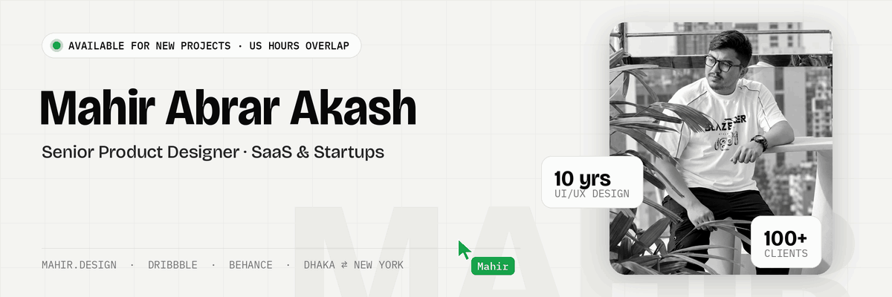

<h3>✦ PRODUCT DESIGN · DESIGN SYSTEMS · WEBSITES THAT CONVERT</h3>

---

## 👋 About me

I'm **Mahir Abrar Akash**, a **senior product designer** in Dhaka, Bangladesh. For ten years I've helped **SaaS teams, startups and digital brands** turn complex products into interfaces people understand instantly. Today I lead product design at [Skribe.ai](https://skribe.ai).

I work where **function, emotion and conversion** meet, and I keep US hours, so your 10am stand-up is my late-night sweet spot.

> **Building something?** Book a 15-minute call and tell me what you're working on. No pitch deck needed: **[cal.com/mahirakash/15min](https://cal.com/mahirakash/15min)**

## 🛠️ What I do

| | Service | What you get |
| :-: | --- | --- |
| 🧭 | **UX Strategy & Flow Design** | User journeys and flows that line up business goals with user needs. Fast, logical, friction-free. |
| 🎨 | **UI & Visual Design** | Clean, modern interfaces with high usability and visual polish, built for clarity and trust. |
| 🧩 | **Design Systems & Documentation** | Component libraries, guidelines and Figma systems that cut friction between design and dev. |
| 🌐 | **Webflow, WordPress & HubSpot Sites** | Marketing sites and landing pages focused on conversion, mobile and SEO basics. |
| 📣 | **Marketing Assets** | Hero banners, launch graphics and product visuals that help the story land. |
| ⚙️ | **Full-Stack Delivery** | Production-ready builds with an engineering team, front end through back end. |

## 🚀 Selected work

| Project | What it is | My role |
| --- | --- | --- |
| **[Skribe](https://www.mahir.design/case-skribe)** | Legaltech platform for depositions, powered by AI | Product design lead |
| **[Vendidit](https://www.mahir.design/case-vendidit)** | Recommerce marketplace and auctions | Product design |
| **[Sendwin](https://www.mahir.design/case-sendwin)** | Multi-login, privacy and productivity tool | Product design |

👉 Full case studies on **[mahir.design](https://www.mahir.design/)** · shots on **[Dribbble](https://dribbble.com/mahirakash)** · projects on **[Behance](https://www.behance.net/mahirakash)**

## 🧪 Things I'm building

| Project | What it is |
| --- | --- |
| **[Ariva](https://arivastudio.com)** | Copy-paste website sections and premium templates for Webflow, Framer and code. |
| **[Rankwright](https://github.com/mahirakash/rankwright)** | Open-source SEO / AEO / GEO tool: audits, JSON-LD generation, IndexNow, rank tracking and publishing. |

## 🧰 Tools I work with

## ❓ FAQ

**Who is Mahir Abrar Akash?**
A senior product designer based in Dhaka, Bangladesh, with ten years in UI/UX and 100+ clients. He designs SaaS products, design systems and marketing websites, and currently leads product design at Skribe.ai.

**Do you work with US teams?**
Yes. I work US hours, so calls, reviews and stand-ups happen in your day, not mine.

**What do you need to get started?**
A 15-minute call. Tell me what you're building and where it's stuck; I'll tell you how I'd approach it. **[Book here](https://cal.com/mahirakash/15min)**.

**Can you also build what you design?**
Yes. I build marketing sites in Webflow, WordPress, HubSpot and code myself, and deliver full products with an engineering team.

---

### 📩 Let's talk about your product

Product designer Bangladesh · SaaS product designer · UI/UX designer Dhaka · design systems · Figma · Webflow designer · startup product design · hire product designer

